<div align="center">

# Hubuddy DeskHub — SIDYA Edition

**Turn any Android phone into a desk dashboard for your Windows PCs and laptops.**
Live stats for up to 8 machines on one screen, Claude Code monitoring, media and shortcut controls,
light and dark themes, a landscape layout with a side rail, and an idle *desk mode* that rotates through
everything while the phone stands beside your keyboard.

[](#compatibility)
[](android/deskhub)
[](docs/deskhub/TEST_REPORT.md)
[](releases)
[-blue)](docs/deskhub/THIRD_PARTY_NOTICES.md)

### [⬇ Download the APK (v1.3.0)](https://github.com/yeshwanthkumardomala/hubuddy/raw/feature/deskhub-android/releases/Hubuddy-DeskHub-1.3.0.apk)

<sub>Android 5.0+ · about 1 MB · [checksum](releases/Hubuddy-DeskHub-1.3.0.apk.sha256) · [all releases](releases)</sub>

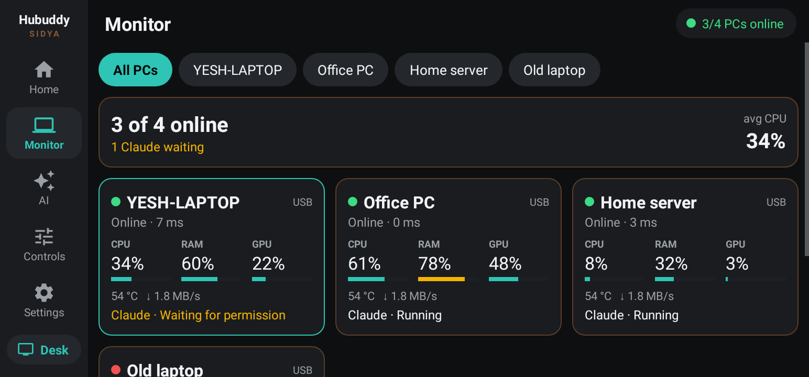

</div>

---

## Screenshots

> Rendered from the real app code with sample data (Android 14 runtime, Vivo 1902-sized screen). They are not photos of a physical phone.

**Landscape: side rail, columns, every PC at once**

<table>
<tr>
<td>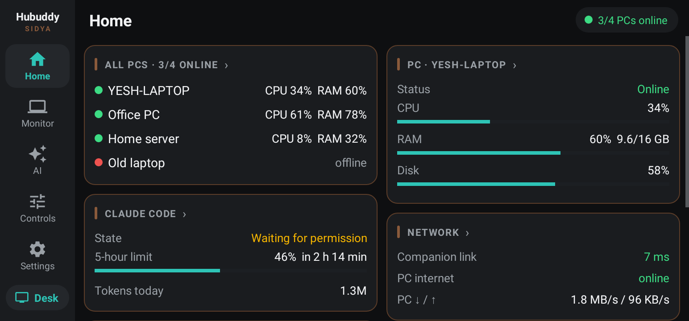</td>
<td>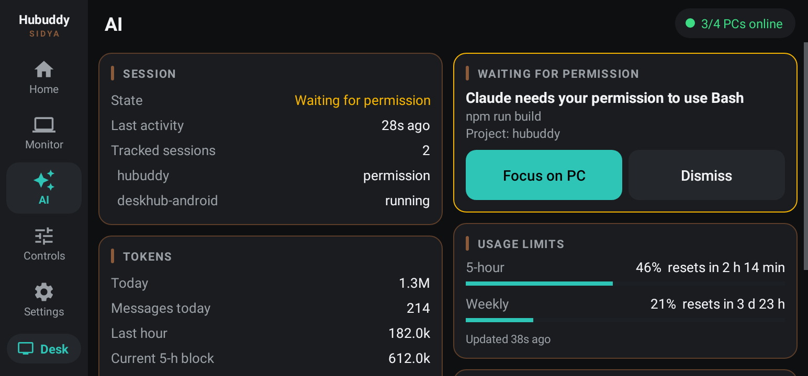</td>
</tr>
<tr>
<td>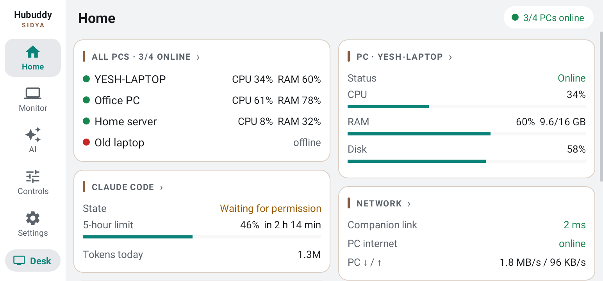</td>
<td>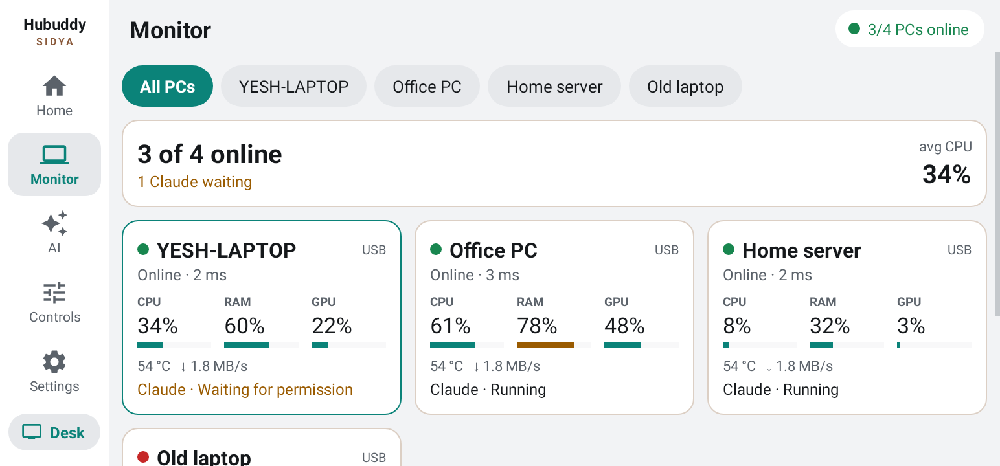</td>
</tr>
</table>

**Portrait, in dark and light**

<table>
<tr>
<td align="center">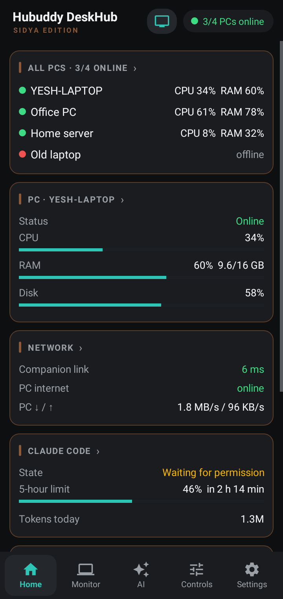<br><sub>Home, several PCs</sub></td>
<td align="center">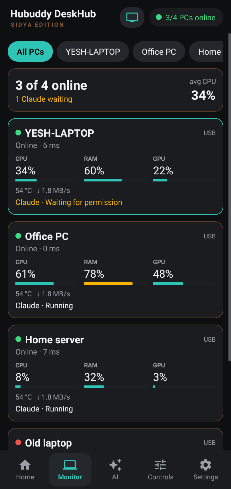<br><sub>All PCs</sub></td>
<td align="center">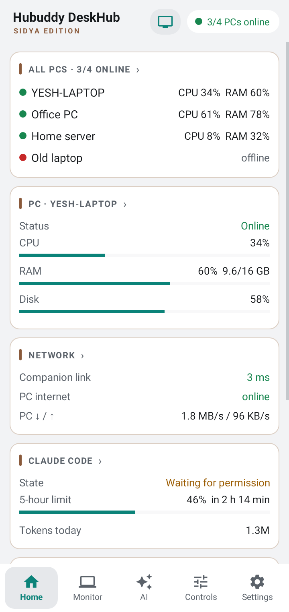<br><sub>Light theme</sub></td>
<td align="center">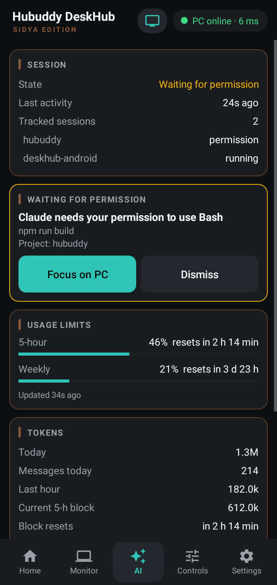<br><sub>Claude Code</sub></td>
<td align="center">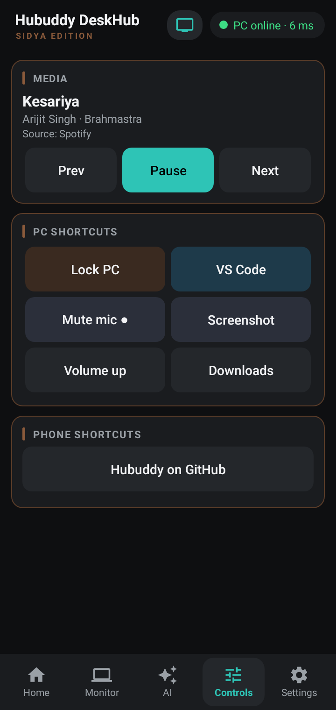<br><sub>Controls</sub></td>
</tr>
</table>

**Desk mode: starts by itself when the phone is left alone**

<table>
<tr>
<td>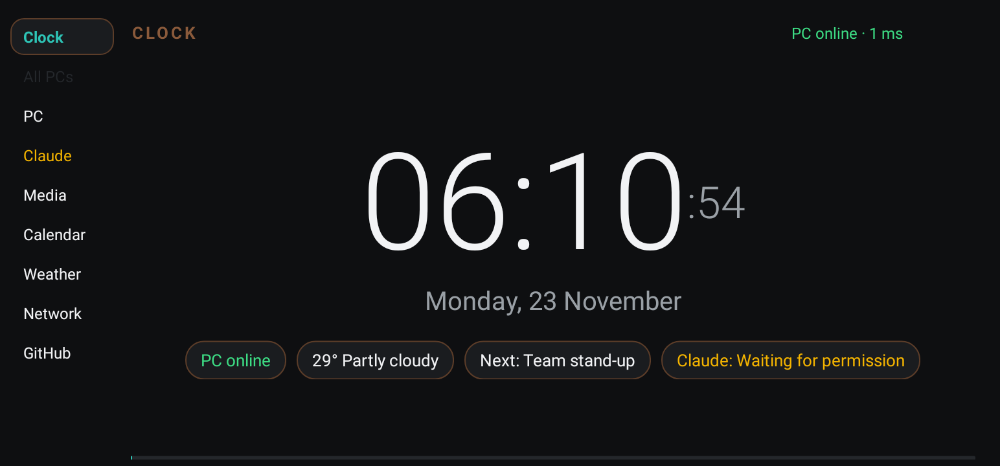</td>
<td>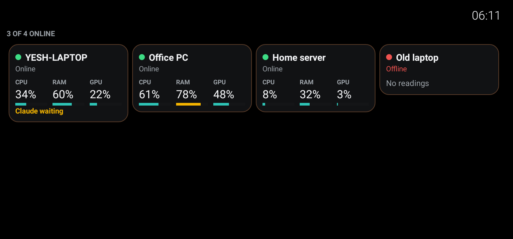</td>
<td>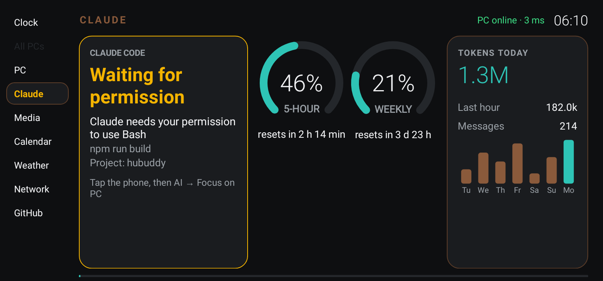</td>
</tr>
<tr>
<td>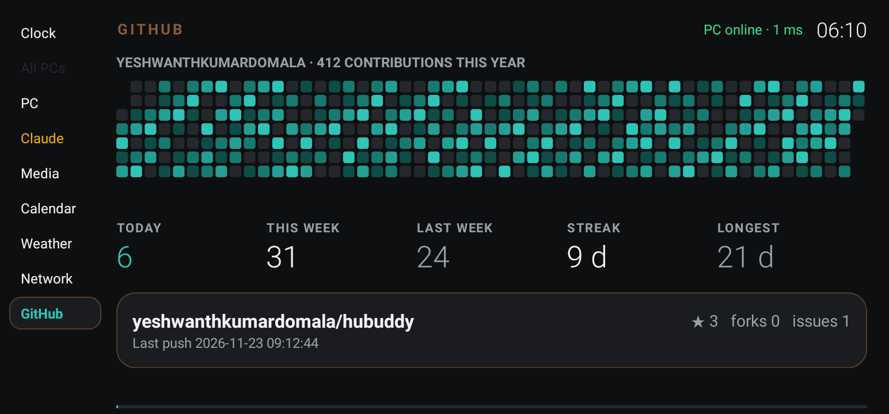</td>
<td>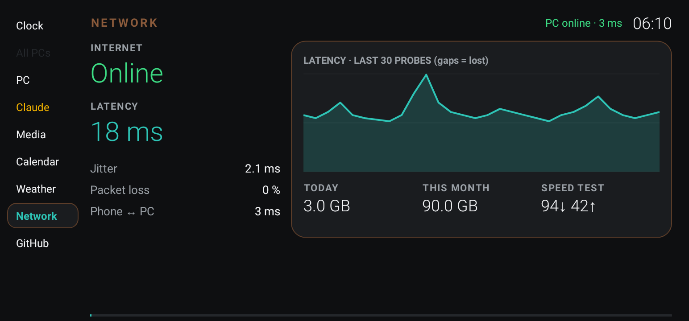</td>
<td>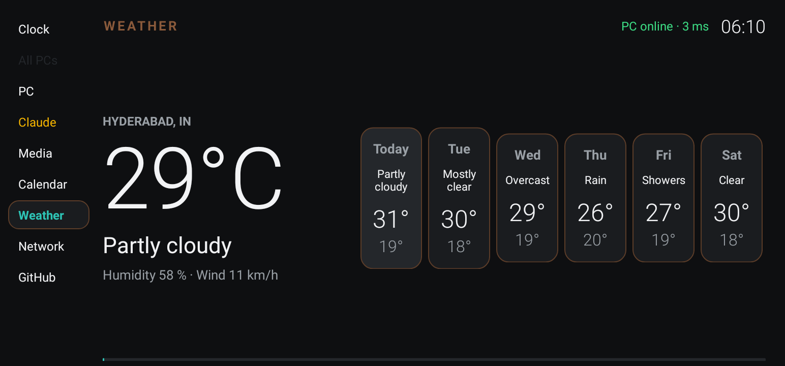</td>
</tr>
</table>

[See every screen →](docs/deskhub/SCREENSHOTS.md)

## Features

| | |
| --- | --- |
| **Up to 8 PCs and laptops** | Connect all your machines and see every reading in one place: the **All PCs** overview shows CPU, RAM, GPU or disk, temperature, network speed and Claude state for each; Home shows a one-line summary; tap one to focus it. Each PC reconnects on its own, so an offline machine never slows the rest |
| **PC monitor** | CPU, RAM, disk, GPU, VRAM and GPU temperature, network throughput, online and display-asleep state |
| **Claude Code** | Running, idle or *waiting for permission*; focus or dismiss the window from the phone; 5-hour and weekly limits with reset times; tokens, per-model use and a 7-day chart |
| **Controls** | Media play, pause and skip; your PC shortcut buttons (confirmed before they run); phone shortcuts for links and apps |
| **Calendar, weather, network, GitHub** | Upcoming events; Open-Meteo forecast for any city; latency, packet loss, data use and speed test; repository stats and a contribution heatmap |
| **Desk mode** | The clock lives here, not on the everyday screens. After 5 idle minutes (also on battery, stopping at 15%) a full-screen landscape display rotates through every page with data, jumps to Claude alerts, dims to a clock at night and guards against burn-in |
| **Looks** | Auto, Dark, Black and Light themes; a side rail and 2 to 4 card columns in landscape; a bottom bar in portrait |
| **Offline first** | Opens with no PC and no internet; shows the clock and the last saved data with its age; reconnects by itself with back-off; never shows invented numbers |
| **Secure by design** | PIN lock with a forced first-login change, lockout and session timeout, Keystore-encrypted secrets, per-device pairing tokens, local-network-only bridge |
| **Tiny and fast** | Native Kotlin with no AndroidX, Material or OkHttp; about 1 MB APK (80 to 100 KB optimised), no background service, polling stops when the app is not visible |

## How it works

```
 PC 1 (Windows)      PC 2 (laptop)     ...up to 8              Phone (Android 5.0+)
 ┌───────────────┐   ┌───────────────┐                        ┌─────────────────────────────┐
 │ DeskHub       │   │ DeskHub       │                        │ Hubuddy DeskHub app         │
 │ companion     │   │ companion     │   USB (one PC)         │   Home · Monitor · AI ·     │
 │ + Hubuddy     │   │ + Hubuddy     │◄─ or Wi-Fi (any) ─────►│   Controls · Settings       │
 │ bridge :8765  │   │ bridge :8765  │   LAN only             │   All PCs overview          │
 └───────────────┘   └───────────────┘                        │   Desk mode (landscape)     │
                                                              └─────────────────────────────┘
```

Each computer runs its own bridge, and the phone pairs with each one separately. The phone never runs
commands itself: it asks a bridge to do a fixed action (media control, shortcut number, alert action), and
that PC decides what it means. Details in the [architecture guide](docs/deskhub/ARCHITECTURE.md).

## Quick start

**1. Install the app.** Download the APK above, open it on the phone and allow *install unknown apps*, or use `adb install -r Hubuddy-DeskHub-1.3.0.apk`.

**2. First login.** Use the temporary login number and PIN from your setup notes. The app makes you
choose your own PIN straight away, and the temporary one stops working.

**3. Start the bridge on the PC** (needs the [DeskHub companion](https://github.com/zacharyinserra/deskhub) set up once with `uv run deskhub-setup`):

```powershell
cd companion-bridge
.\start-bridge.ps1 -Companion C:\path\to\deskhub\companion          # USB: runs adb reverse for you
.\start-bridge.ps1 -Companion C:\path\to\deskhub\companion -Lan     # or Wi-Fi, same network only
```

**4. Pair.** The bridge prints a 6-digit code. In the app: *Settings → PCs and laptops* (USB, or Wi-Fi with
the PC's IP) → *Test connection* → enter the code → *Pair*.

**More computers?** Start a bridge with `-Lan` on each one, then in the app tap *+ Add PC*, enter its IP and
pair it the same way (up to 8; USB serves one cable, so use Wi-Fi for the others). Then open
*Monitor → All PCs*.

**5. Put the phone on a stand and leave it.** After 5 idle minutes desk mode starts on its own and shows the time first. Plugging the phone in is recommended; on battery it stops at 15%.

Full guide: [companion and API setup](docs/deskhub/API_SETUP.md).

## Compatibility

| Phone | Status |
| --- | --- |
| Android 5.0 and newer, any brand | Supported. Tested in simulation on Android 5.0, 7.0, 8.0, 9, 11 and 14 |
| Android 5.0 to 7.0 | Weather and GitHub cards may show "unavailable" if the phone does not trust those sites' certificates. PC data is unaffected |
| iPhone and other devices | No app; use the web dashboard the bridge serves at `http://<PC>:8765` |

> **Status:** built for a Vivo 1902 (Android 9). Automated tests pass, but **testing on a physical phone is still pending.**
> Windows PowerShell scripts have not been run yet either. See the [test report](docs/deskhub/TEST_REPORT.md).

## Security notes

- Plain HTTP is **not encrypted**. USB mode keeps traffic on the cable; on Wi-Fi use a network you trust.
- The bridge listens on `127.0.0.1` by default; `--lan` only accepts private-network clients, and the app refuses to send its token to a public address.
- Do not forward the bridge's port on your router.
- The first-login credentials are temporary bootstrap values and can be overridden at build time.

## Build from source

```powershell
cd android\deskhub
.\build.ps1                  # unit tests + debug APK
.\build.ps1 -Release -Lint   # optimised release APK and Android Lint
```

Needs JDK 17+ and the Android SDK (Platform 34). See [build instructions](docs/deskhub/BUILD_INSTRUCTIONS.md).

## Repository layout

```
android/deskhub/     Android app (Kotlin) and build.ps1
companion-bridge/    PC bridge (Python standard library), start-bridge.ps1, web dashboard
docs/deskhub/        Architecture, build, API setup, test report, release notes, screenshots
releases/            Installable APK and checksum
```

## Documentation

[Architecture](docs/deskhub/ARCHITECTURE.md) ·
[Build instructions](docs/deskhub/BUILD_INSTRUCTIONS.md) ·
[Companion and API setup](docs/deskhub/API_SETUP.md) ·
[Test report](docs/deskhub/TEST_REPORT.md) ·
[Release notes](docs/deskhub/RELEASE_NOTES.md) ·
[Screenshots](docs/deskhub/SCREENSHOTS.md) ·
[Third-party notices](docs/deskhub/THIRD_PARTY_NOTICES.md)

## Credits

Adapted from [DeskHub](https://github.com/zacharyinserra/deskhub) by Desk Hub contributors (MIT License), whose
companion code supplies the PC data. Weather and geocoding by [Open-Meteo](https://open-meteo.com).
