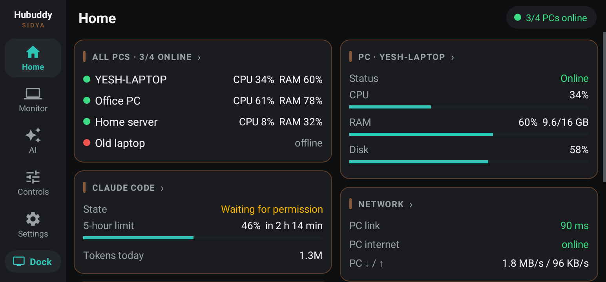
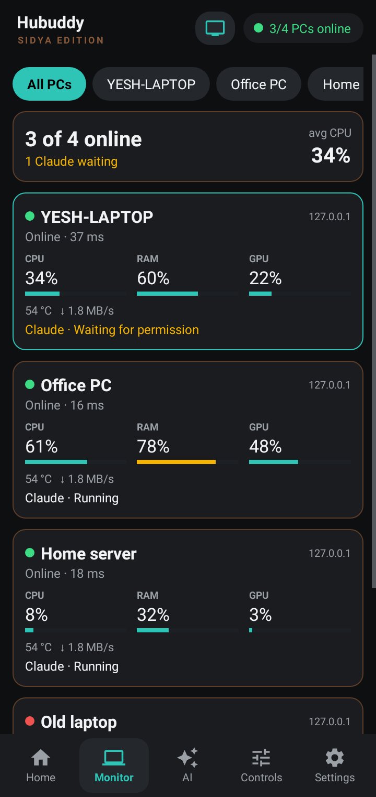
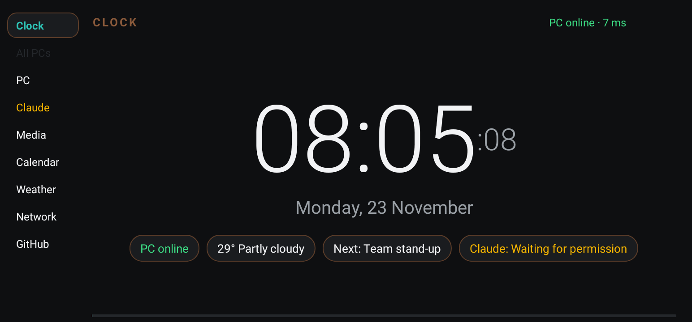
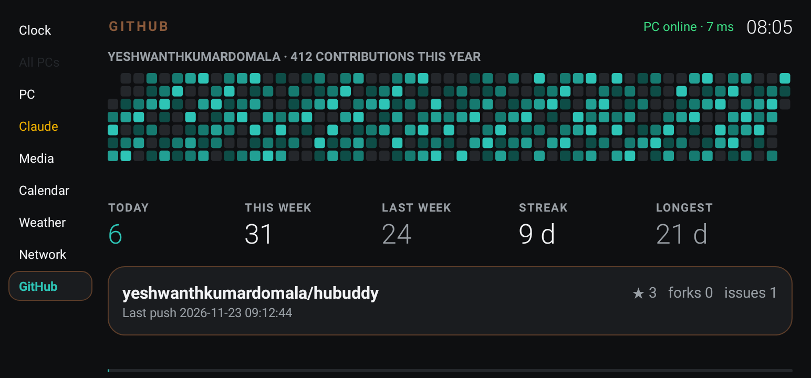

<div align="center">

# Hubuddy

**A dashboard and dock display on your phone for all your PCs and laptops.**
See live stats for up to 8 machines on one screen, watch Claude Code, control media and shortcuts, and let the
phone turn into a landscape clock-and-status display when you leave it alone.

[](#compatibility)
[](android/hubuddy)
[](agent)
[](docs/hubuddy/TEST_REPORT.md)
[](releases)

### Downloads (v2.0.0)

| 📱 Phone app | 💻 Laptop / PC agent |
| --- | --- |
| [**⬇ Hubuddy-2.0.0.apk**](https://github.com/yeshwanthkumardomala/hubuddy/raw/feature/hubuddy-app/releases/Hubuddy-2.0.0.apk) | [**⬇ Hubuddy-Agent-2.0.0.zip**](https://github.com/yeshwanthkumardomala/hubuddy/raw/feature/hubuddy-app/releases/Hubuddy-Agent-2.0.0.zip) |
| Android 5.0+ · about 1 MB | Windows + Python 3.11+ · about 40 KB, double-click to start |

<sub>You need both: the app on the phone and the agent on each PC. Checksums and install steps: [all releases](releases)</sub>


</div>

---

## Screenshots

> Rendered from the real app code with sample data (Android 14 runtime, Vivo 1902-sized screen). They are not photos of a physical phone.

**Landscape: side rail, columns, every PC at once**

<table>
<tr>
<td></td>
<td></td>
</tr>
<tr>
<td></td>
<td></td>
</tr>
</table>

**Portrait, dark and light**

<table>
<tr>
<td align="center"><br><sub>Home, several PCs</sub></td>
<td align="center"><br><sub>All PCs</sub></td>
<td align="center"><br><sub>Light theme</sub></td>
<td align="center"><br><sub>Claude Code</sub></td>
<td align="center"><br><sub>Controls</sub></td>
</tr>
</table>

**Dock mode: starts by itself when the phone is left alone**

<table>
<tr>
<td></td>
<td></td>
<td></td>
</tr>
<tr>
<td></td>
<td></td>
<td></td>
</tr>
</table>

[See every screen →](docs/hubuddy/SCREENSHOTS.md)

## Features

| | |
| --- | --- |
| **Up to 8 PCs and laptops** | The **All PCs** overview shows each machine's CPU, RAM, GPU or disk, temperature, network speed and Claude state at once. Each reconnects on its own, so an offline machine never slows the rest |
| **PC monitor** | CPU, RAM, disk, NVIDIA GPU load, temperature and VRAM, network throughput, internet health with latency, loss and a speed test |
| **Claude Code** | Running, idle or *waiting for permission*; 5-hour and weekly limits with reset times; tokens, per-model use and a 7-day chart |
| **Controls** | Media play, pause and skip; your own PC shortcut buttons (confirmed before they run); phone shortcuts for links and apps |
| **Calendar, weather, GitHub** | Upcoming events from any ICS link; Open-Meteo forecast for any city; repository stats and a contribution heatmap |
| **Dock mode** | After 5 idle minutes (also on battery, stopping at 15%) a full-screen landscape display shows the clock, then each page with data in turn, jumps to Claude alerts, dims at night and guards against burn-in |
| **Looks** | Auto, Dark, Black and Light themes; a side rail and 2 to 4 card columns in landscape; a bottom bar in portrait |
| **Offline first** | Opens with no PC and no internet; shows the last readings with their age; never shows invented numbers |
| **Secure by design** | PIN lock with a forced first-login change, lockout and session timeout, Keystore-encrypted secrets, a pairing code and a separate token for every phone, agents reachable on your local network only |
| **Tiny and fast** | Native Kotlin with no AndroidX, Material or OkHttp; about 1 MB; no background service; polling stops when the app is not visible |

## How it works

```
 PC 1 (Windows)      PC 2 (laptop)     ...up to 8              Phone (Android 5.0+)
 ┌───────────────┐   ┌───────────────┐                        ┌─────────────────────────────┐
 │ Hubuddy agent │   │ Hubuddy agent │   USB (one PC)         │ Hubuddy app                 │
 │   :8765       │   │   :8765       │◄─ or Wi-Fi (any) ─────►│   Home · Monitor · AI ·     │
 │ collectors    │   │ collectors    │   LAN only             │   Controls · Settings       │
 └───────────────┘   └───────────────┘                        │   All PCs · Dock mode       │
                                                              └─────────────────────────────┘
```

A small **agent** runs on each computer and serves its readings; the **app** pairs with each agent separately. The
phone never runs commands itself: it asks an agent for a fixed action (media control, a shortcut number, dismiss
an alert), and that PC decides what it means. Details in the [architecture guide](docs/hubuddy/ARCHITECTURE.md).

## Quick start

**1. Download both** from the table above (or from [releases](releases)). Install the app: open the APK on the phone
and allow *install unknown apps*, or run `adb install -r Hubuddy-2.0.0.apk`.

**2. First login.** Use the temporary login number and PIN you built the app with (see
[build instructions](docs/hubuddy/BUILD_INSTRUCTIONS.md)). The app makes you choose your own PIN straight away.

**3. Start the agent on the PC.** Install Python 3.11+, unzip `Hubuddy-Agent-2.0.0.zip` and double-click
`start-agent.bat` (or, from a clone of this repository, run it in PowerShell):

```powershell
cd agent
.\start-agent.ps1            # USB: runs adb reverse for you
.\start-agent.ps1 -Lan       # or Wi-Fi, same network only
```

**4. Pair.** The agent prints a 6-digit code. In the app: *Settings → PCs and laptops* → *Test connection* →
enter the code → *Pair*. **More computers?** Start an agent on each one with `-Lan`, tap *+ Add PC*, enter its IP
and pair it the same way (up to 8). Then open *Monitor → All PCs*.

**5. Put the phone on a stand and leave it.** After 5 idle minutes dock mode starts and shows the time first.

Optional: add calendar links and shortcut buttons in `agent/config.toml`, and run
`python -m hubuddy_agent.claude_setup apply` for Claude Code limits and alerts. Full guide:
[agent setup and API](docs/hubuddy/API_SETUP.md).

## Compatibility

| Phone | Status |
| --- | --- |
| Android 5.0 and newer, any brand | Supported. Tested in simulation on Android 5.0, 7.0, 8.0, 9, 11 and 14 |
| Android 5.0 to 7.0 | Weather and GitHub cards may show "unavailable" on old certificate stores; PC data is unaffected |
| iPhone and other devices | No app; use the web dashboard the agent serves at `http://<PC>:8765` |

> **Status:** automated tests pass, but **testing on a physical phone is still pending**, and the Windows
> PowerShell scripts and Windows-only agent parts have not been run on Windows. See the [test report](docs/hubuddy/TEST_REPORT.md).

## Security notes

- Plain HTTP is **not encrypted**. USB mode keeps traffic on the cable; on Wi-Fi use a network you trust.
- The agent listens on `127.0.0.1` by default; `--lan` accepts only private-network clients, and the app refuses to send its token to a public address.
- Do not forward the agent's port on your router.
- The first-login credentials are temporary, are not stored in this repository, and are baked into your own build.

## Build from source

```powershell
cd android\hubuddy
.\build.ps1                  # unit tests + debug APK
.\build.ps1 -Release -Lint   # optimised release APK and Android Lint
```

Needs JDK 17+ and the Android SDK (Platform 34). See [build instructions](docs/hubuddy/BUILD_INSTRUCTIONS.md).

## Repository layout

```
android/hubuddy/   Android app (Kotlin) and build.ps1
agent/             PC agent (Python), start-agent.ps1, config.example.toml, web dashboard
docs/hubuddy/      Architecture, build, setup, test report, release notes, screenshots
releases/          Downloads: phone APK and laptop agent zip, with checksums
tools/             package_agent.py builds the laptop agent zip
```

## Documentation

[Architecture](docs/hubuddy/ARCHITECTURE.md) · [Build instructions](docs/hubuddy/BUILD_INSTRUCTIONS.md) ·
[Agent setup and API](docs/hubuddy/API_SETUP.md) · [Test report](docs/hubuddy/TEST_REPORT.md) ·
[Release notes](docs/hubuddy/RELEASE_NOTES.md) · [Screenshots](docs/hubuddy/SCREENSHOTS.md) ·
[Libraries](docs/hubuddy/LIBRARIES.md)

Weather and place search by [Open-Meteo](https://open-meteo.com).
