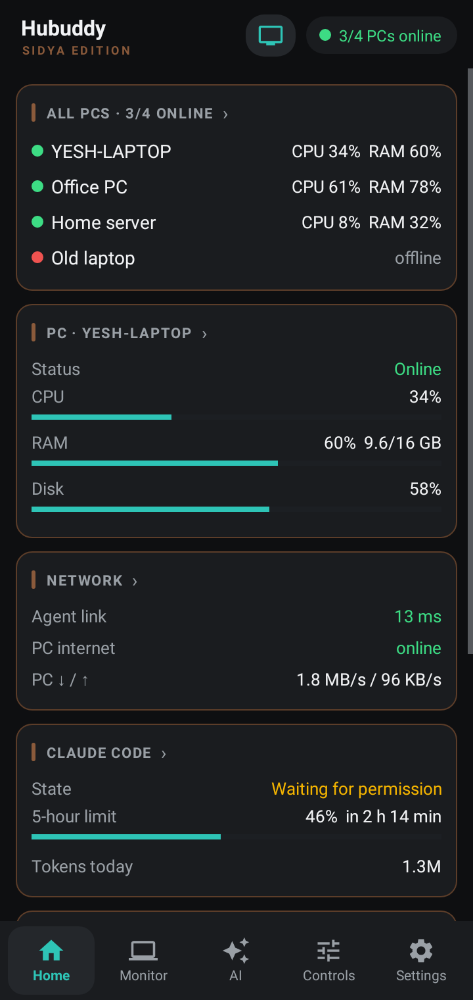
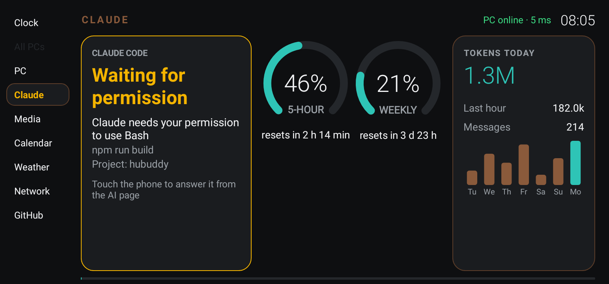
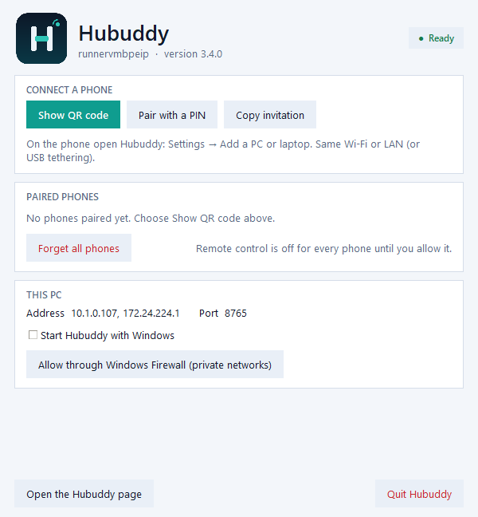

<div align="center">


# Hubuddy

**A dashboard and dock display on your phone for all your PCs and laptops.**
See live stats for up to 8 machines on one screen, watch Claude Code, control media and shortcuts, send text, links
and files both ways, and let the phone turn into a landscape clock-and-status display when you leave it alone.

[](#compatibility)
[](#install-on-the-pc)
[](#install-on-linux-debian-12-ubuntu-2204-light-installs-old-pcs)
[](android/hubuddy)
[](agent)
[](https://github.com/yeshwanthkumardomala/hubuddy/actions/workflows/build.yml)

### Downloads (v3.4.0)

| 📱 Phone app | 💻 Windows program | 💻 Windows installer | 🐧 Debian / Ubuntu / Linux |
| --- | --- | --- | --- |
| [**Hubuddy-3.4.0.apk**](releases/Hubuddy-3.4.0.apk) | [**Hubuddy-3.4.0.exe**](releases/Hubuddy-3.4.0.exe) | [**HubuddySetup-3.4.0.exe**](releases/HubuddySetup-3.4.0.exe) | [**hubuddy_3.4.0_all.deb**](releases/hubuddy_3.4.0_all.deb) |
| Android 5.0+ · about 170 KB | Windows 10/11 · portable, no install | adds Start menu, firewall rule, autostart option | any CPU, no desktop needed · about 100 KB |

<sub>You need the app on the phone and the program on each PC. Checksums, install steps and the
[Releases page](https://github.com/yeshwanthkumardomala/hubuddy/releases): [all downloads](releases)</sub>


</div>

---

## What's new

* **3.4.0:** a new logo, a Windows window that opens instantly and never freezes, a new-generation window design (dark/light, status pill, per-phone remote switch),
  and **keyboard chords** on the phone: hold Ctrl / Shift / Alt / Win with one finger and tap another key, F1 to F12 included.
* **3.3.0:** no sign-in, and a rebuilt trackpad (tap, two-finger scroll/right-click, pinch zoom, drag, speed slider).
* **3.2.0:** Linux (a small Debian package that runs without a desktop). **3.1.0:** remote control and Wake-on-LAN. **3.0.0:** QR/PIN pairing, encrypted and pinned.
  All versions: [release notes](docs/hubuddy/RELEASE_NOTES.md).

## Connect in a minute: no developer options, no cable, no typing IPs

Phone and PC just need to be on the **same Wi-Fi or LAN**, or connected by **USB tethering** (the ordinary switch in
the phone's Hotspot & tethering settings, which makes the cable behave like a small network).

1. **On the PC:** open `Hubuddy.exe`, then click **Pair a phone** (a QR code appears) or **Pair with a PIN**.
2. **On the phone:** Settings → **Add a PC or laptop** → **Scan QR code**. No camera? Choose **Find PCs on this network**,
   tap your PC, check that the *compare code* matches the one on the PC, and type the PIN.
3. Done. Add more PCs the same way (up to 8), and pair more phones to the same PC (up to 32). If a PC's address changes,
   the phone finds it again by itself.

Everything between phone and PC is encrypted and pinned to *that* PC's own identity, so a stranger on the Wi-Fi cannot
pose as your computer. [How pairing works](docs/hubuddy/ARCHITECTURE.md#pairing-and-transport-how-a-phone-comes-to-trust-a-pc)

## Screenshots

> Rendered from the real app code with sample data (Android 14 runtime, Vivo 1902-sized screen). They are not photos of a physical phone.

**Landscape: side rail, columns, every PC at once**

<table>
<tr>
<td></td>
<td></td>
</tr>
<tr>
<td></td>
<td></td>
</tr>
</table>

**Portrait, dark and light**

<table>
<tr>
<td align="center"><br><sub>Home, several PCs</sub></td>
<td align="center"><br><sub>All PCs</sub></td>
<td align="center"><br><sub>Light theme</sub></td>
<td align="center"><br><sub>Claude Code</sub></td>
<td align="center"><br><sub>Controls</sub></td>
</tr>
</table>

**Dock mode: starts by itself when the phone is left alone**

<table>
<tr>
<td></td>
<td></td>
<td></td>
</tr>
<tr>
<td></td>
<td></td>
<td></td>
</tr>
</table>

[See every screen →](docs/hubuddy/SCREENSHOTS.md)

## Features

| | |
| --- | --- |
| **Up to 8 PCs and laptops** | The **All PCs** overview shows each machine's CPU, RAM, GPU or disk, temperature, network speed and Claude state at once. Each reconnects on its own, so an offline machine never slows the rest |
| **Many phones too** | Pair several phones with one PC; each has its own key and can be forgotten alone |
| **Three ways in** | QR code, PIN with compare code, or the same Wi-Fi/LAN (including USB tethering): discovery finds the PC for you |
| **Two-way** | Send text, links and your clipboard to the PC; the PC sends text and links to the phone; files go both ways (picked with Android's own file pickers); the PC shows each phone's battery and network |
| **PC monitor** | CPU, RAM, disk, NVIDIA GPU load, temperature and VRAM, network throughput, internet health with latency, loss and a speed test |
| **Claude Code** | Running, idle or *waiting for permission*; 5-hour and weekly limits with reset times; tokens, per-model use and a 7-day chart |
| **Remote control** | A real touchpad (tap, two-finger scroll and right-click, pinch zoom, drag, adjustable speed), a keyboard with **chords** (hold Ctrl/Shift/Alt/Win and tap a key, F1 to F12, A to Z), shortcuts, volume and power from the phone. **Off until you allow it per phone on the PC**; Wake a sleeping PC (Wake-on-LAN) |
| **The PC window** | Opens instantly, follows Windows light/dark, shows the pairing QR code or PIN, the phones with a *Remote control* switch and *Forget* each, firewall and start-with-Windows settings |
| **Controls** | Media play, pause and skip; your own PC shortcut buttons (confirmed before they run); phone shortcuts for links and apps |
| **Calendar, weather, GitHub** | Upcoming events from any ICS link; Open-Meteo forecast for any city; repository stats and a contribution heatmap |
| **Dock mode** | After 5 idle minutes (also on battery, stopping at 15%) a full-screen landscape display shows the clock, then each page with data in turn, jumps to Claude alerts, dims at night and guards against burn-in |
| **Looks** | Auto, Dark, Black and Light themes; a side rail and 2 to 4 card columns in landscape; a bottom bar in portrait |
| **Offline first** | Opens with no PC and no internet; shows the last readings with their age; never shows invented numbers |
| **Secure by design** | No sign-in needed: the app opens straight to the dashboard (an optional PIN lock with lockout and timeout can be switched on in Settings), Keystore-encrypted secrets, per-PC pinned certificates, one-time pairing secrets, per-phone tokens, private networks only |
| **Tiny and fast** | Native Kotlin with no AndroidX, Material or OkHttp; no background service; polling stops when the app is not visible |

Planned next: brightness, app launcher and decks, screenshots, timers and world clocks, a rebuilt Settings main page, and Hindi and Telugu. See [release notes](docs/hubuddy/RELEASE_NOTES.md).

## How it works

```
 PC 1 (Windows)      PC 2 (laptop)     ...up to 8              Phone(s) (Android 5.0+)
 ┌───────────────┐   ┌───────────────┐   same Wi-Fi / LAN     ┌─────────────────────────────┐
 │ Hubuddy       │   │ Hubuddy       │◄─ or USB tethering ───►│ Hubuddy app                 │
 │  HTTPS :8765  │   │  HTTPS :8765  │   (private only)       │   Home · Monitor · AI ·     │
 │  UDP 41236    │   │  UDP 41236    │                        │   Controls · Settings       │
 └───────────────┘   └───────────────┘                        │   All PCs · Dock · Send     │
                                                              └─────────────────────────────┘
```

A small program runs on each computer and serves its readings; the app pairs with each one separately. The phone never
runs commands itself: it asks for a fixed action (media control, a shortcut number, dismiss an alert, send something) and
that PC decides what it means. Details in the [architecture guide](docs/hubuddy/ARCHITECTURE.md).

## The PC window

<p align="center"></p>

<sub>Taken by CI on a real Windows desktop (light theme; it follows your Windows light/dark setting). With the QR code open it also shows the code inside the window.</sub>

## Install on the PC

* **Installer (recommended):** run `HubuddySetup-3.4.0.exe`. It adds a Start menu entry, can allow phones through the
  Windows Firewall for **private** networks only, and can start Hubuddy when you sign in.
* **Portable:** run `Hubuddy-3.4.0.exe` anywhere. Click *Allow through Windows Firewall* in its window once.
* **From source:** Python 3.11+, `pip install -r agent/requirements.txt`, `python -m hubuddy_agent.launcher`.

The programs are not code-signed, so Windows SmartScreen may say "unknown publisher": choose *More info → Run anyway*.
Verify a download with the `.sha256` files. Optional calendar links, shortcut buttons and Claude Code limits are set up
in [PC setup and API](docs/hubuddy/API_SETUP.md).

## Install on Linux (Debian 12, Ubuntu 22.04+, light installs, old PCs)

```bash
sudo apt install ./hubuddy_3.4.0_all.deb       # pulls in python3, psutil and cryptography from your distribution
hubuddy --show-invite                          # prints a pairing QR code in the terminal (or: hubuddy --pin)
systemctl --user enable --now hubuddy          # optional: start at login, runs without a window
hubuddy --firewall-help                        # ufw / firewalld commands for your private network
```

No desktop is required (a browser on the same PC can open `http://127.0.0.1:8766/` instead of the terminal). It uses about 38 MB
of memory when idle. On a desktop you can also run `hubuddy-window` (needs `python3-tk`). For the touchpad and keyboard install `xdotool`; for the
clipboard `xclip` or `wl-clipboard`. Needs Python 3.11 or newer: Debian 12 has it, Debian 11 and Ubuntu 20.04 do not. Other systems: run
from source with `pip install -r agent/requirements.txt` and `python -m hubuddy_agent`.

## Install on the phone

Open `Hubuddy-3.4.0.apk` on the phone and allow *install unknown apps*. There is **no sign-in**: the app opens straight to the dashboard.
If other people use the phone, switch on *Settings → Security & app lock* and choose your own PIN.

## Compatibility

| Phone | Status |
| --- | --- |
| Android 5.0 and newer, any brand | Supported. Tested in simulation on Android 5.0, 7.0, 8.0, 9, 11 and 14 |
| Android 5.0 to 7.0 | Weather and GitHub cards may show "unavailable" on old certificate stores; PC data is unaffected (it uses its own pinned certificate) |
| Android 4.4 and older | Not supported (no usable TLS 1.2 or safe key storage) |
| iPhone and other devices | No app |

> **Status:** the automated tests pass (see the [test report](docs/hubuddy/TEST_REPORT.md)) and the Windows program is
> built and self-tested on a real Windows machine in CI, but **testing on a physical phone is still pending**: camera QR
> scanning, USB tethering, the Keystore on a device and firewall behaviour on your own network have not been tried on
> real hardware.

## Security notes

- Everything between phone and PC is HTTPS with a certificate authority private to each PC, pinned by the phone.
- QR is the strongest way to pair. A PIN is safe when you compare the code on both screens first.
- Only private-network clients are served and the app refuses to talk to public addresses. Do not forward the port on your router.
- Remote actions are fixed verbs with validated arguments; files are confined to two folders under `Documents\Hubuddy`.
- The app lock is optional (Settings → Security & app lock) and uses your own PIN; nothing is baked into the app.

## Build from source

```powershell
cd android\hubuddy
.\build.ps1                  # unit tests + debug APK
.\build.ps1 -Release -Lint   # optimised release APK and Android Lint
```

Needs JDK 17+ and the Android SDK (Platform 34). The Windows program is built by [CI](.github/workflows/build.yml) with
PyInstaller and Inno Setup. See [build instructions](docs/hubuddy/BUILD_INSTRUCTIONS.md).

## Repository layout

```
android/hubuddy/   Android app (Kotlin) and build.ps1
agent/             PC program (Python): server, pairing, launcher window, collectors, tests
installer/         Inno Setup recipe for HubuddySetup.exe
.github/workflows/ CI: tests, Windows build, installer, release
docs/hubuddy/      Architecture, build, setup, test report, release notes, screenshots
releases/          Downloads: APK, Hubuddy.exe, HubuddySetup.exe, checksums
tools/             interop test, test-certificate generator, source-zip packager
```

## Documentation

[Architecture](docs/hubuddy/ARCHITECTURE.md) · [Build instructions](docs/hubuddy/BUILD_INSTRUCTIONS.md) ·
[PC setup and API](docs/hubuddy/API_SETUP.md) · [Test report](docs/hubuddy/TEST_REPORT.md) ·
[Release notes](docs/hubuddy/RELEASE_NOTES.md) · [Screenshots](docs/hubuddy/SCREENSHOTS.md) ·
[Libraries](docs/hubuddy/LIBRARIES.md) · [Notice](NOTICE)

Weather and place search by [Open-Meteo](https://open-meteo.com). The pairing design follows the approach of the Tara
project (MIT), credited in [NOTICE](NOTICE).
