# Screenshots

**Phone app:** rendered from the real app code with Robolectric (Android 14 runtime, 720 × 1520 px,
close to the Vivo 1902 screen). Sample data comes from a fake PC companion; these are not photos of
a physical phone. To regenerate them:
`gradlew testDebugUnitTest --tests "*Screenshots*" -Pscreenshots=<folder>`

| | | |
| --- | --- | --- |
| 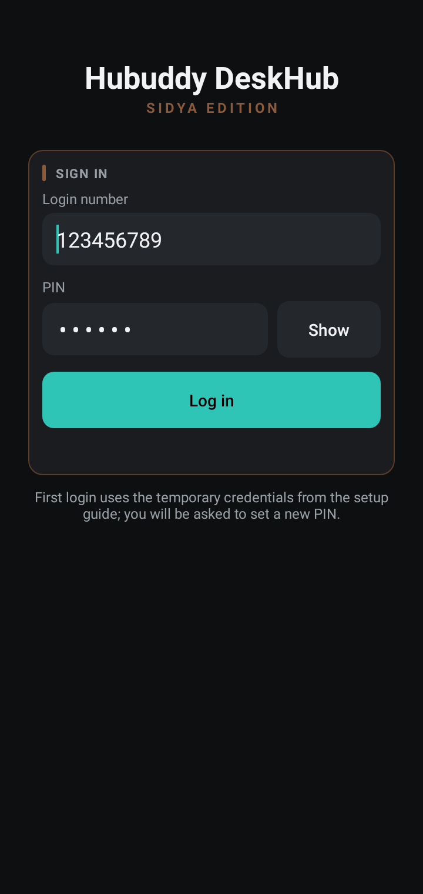 Login | 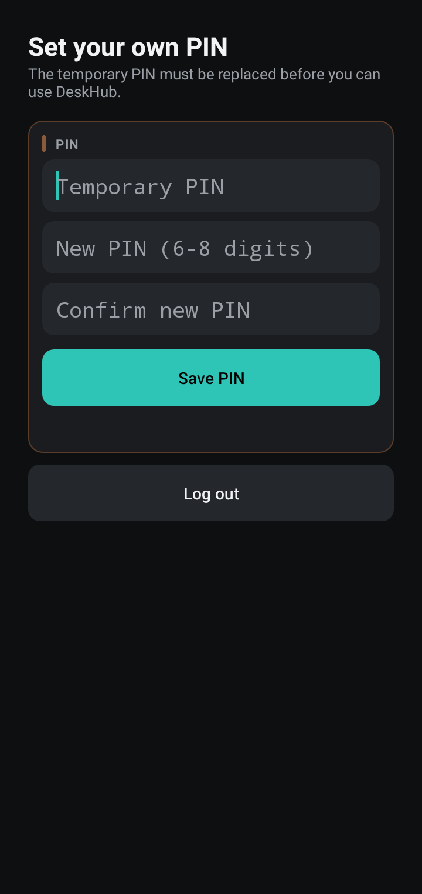 First-login PIN change | 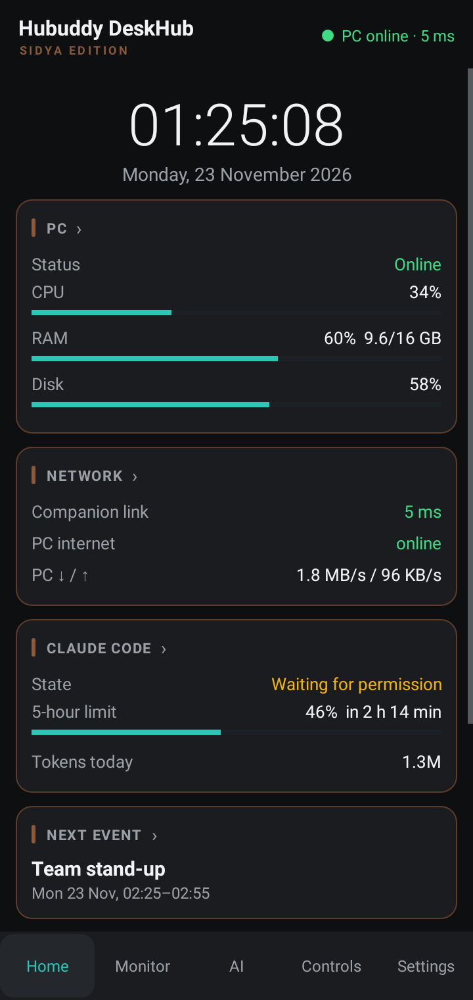 Home |
| 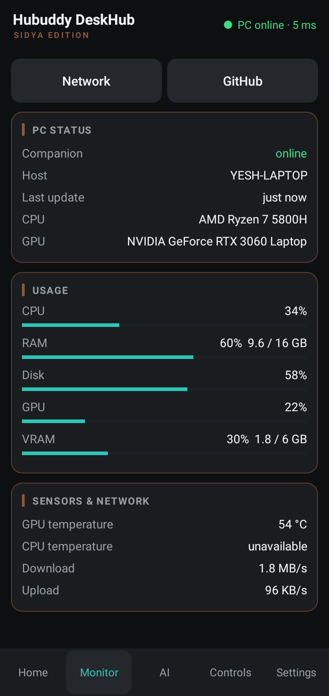 Monitor |  Network |  GitHub |
| 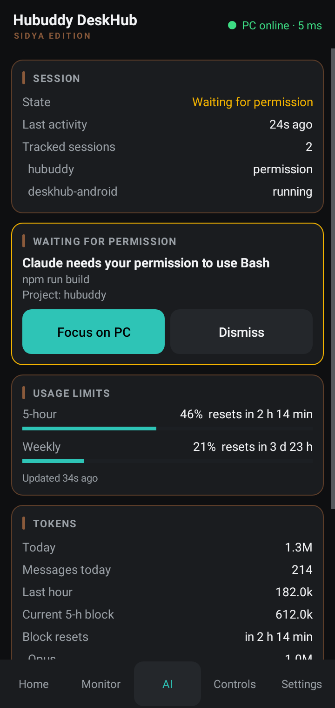 AI / Claude Code | 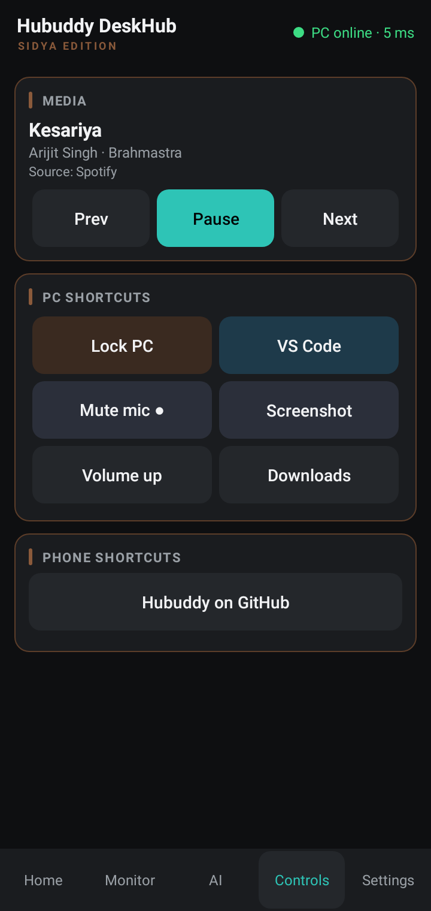 Controls |  Calendar |
|  Weather | 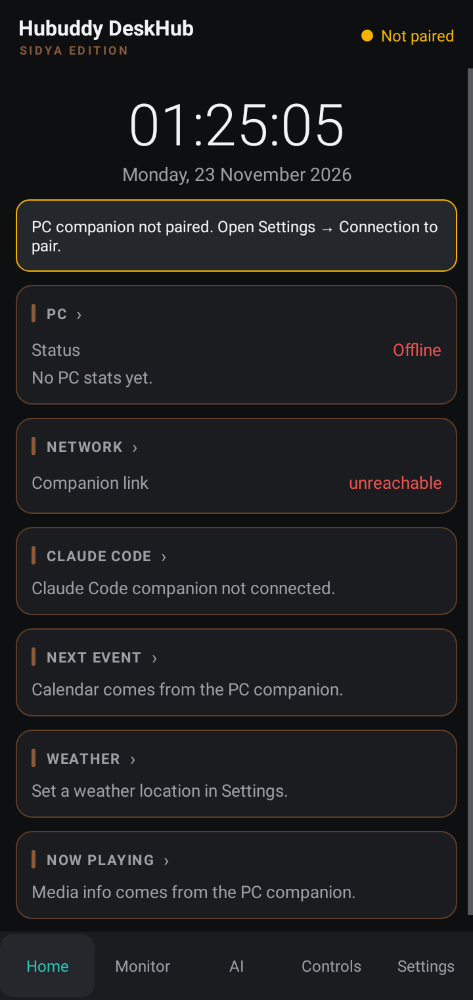 Offline / not paired | 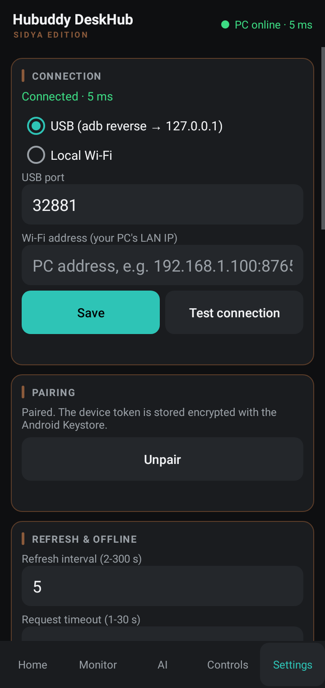 Settings |

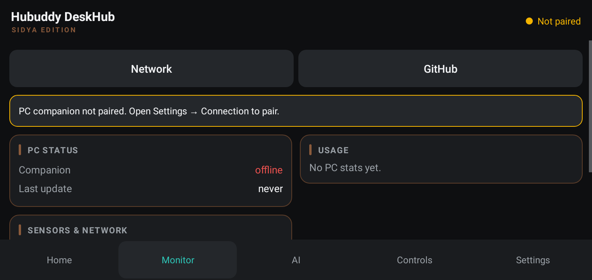
Landscape (two columns)

**Laptop side:** the bridge console (real output; two lines that only appear on Linux were
removed) and the optional web dashboard in Chromium.

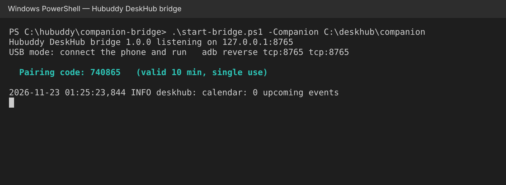
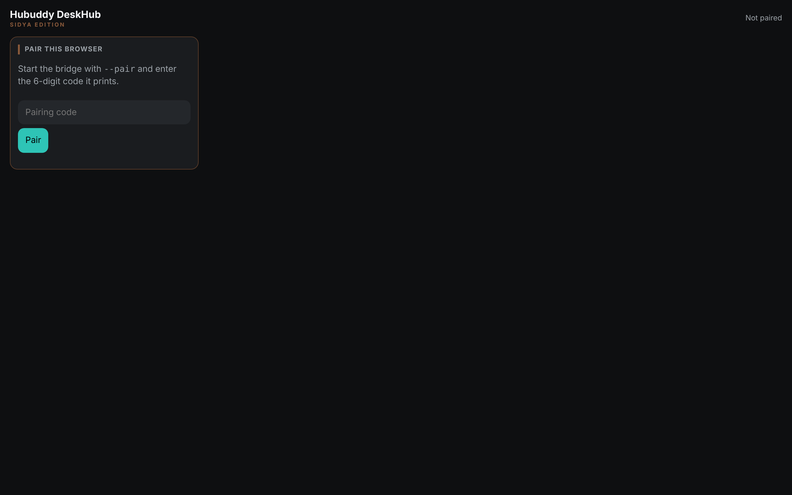
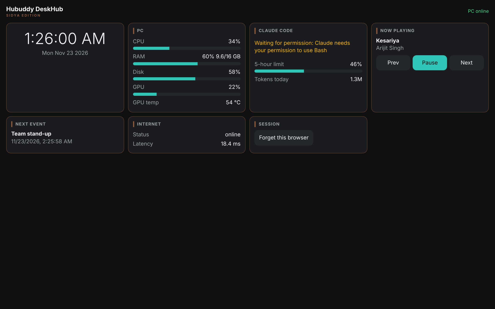
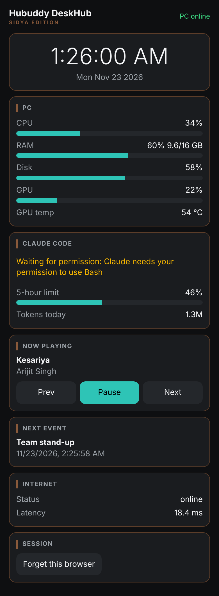
